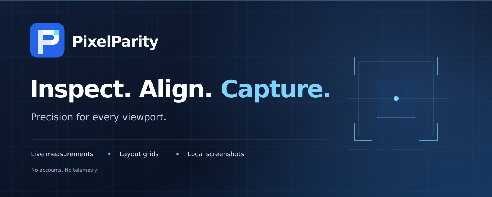

# PixelParity — Layout, Grid & Capture

**Inspect the layout. Check the alignment. Capture the evidence.**

PixelParity is a Chrome extension for frontend developers, designers, and QA engineers.
Bring live viewport measurements, adjustable page grids, element inspection, and local
screenshots into one tab-scoped side panel.

[Chrome Web Store](https://chromewebstore.google.com/detail/nobkjipoljcbnldmicopkjkbinggcipa)
· [Privacy](PRIVACY.md) · [Changelog](CHANGELOG.md)
· [Report an issue](https://github.com/aaarslan/pixelparity/issues)



**3.0.0 release candidate:** implementation and local checks are complete. Installed-Chrome
qualification, five new product screenshots, and Web Store submission remain pending.
See the [release checklist](store/release-checklist.md) for the exact evidence and status.

## Your layout toolkit

| Tool | What it helps you do |
| --- | --- |
| **Live inspection** | Follow layout and visual viewports, browser zoom, DPR, screen dimensions, typography, and responsive breakpoints. |
| **Grid overlays** | Check alignment with column, square, or baseline grids. Tune columns, gutters, margins, maximum width, spacing, color, and opacity. Toggle them off at any time. |
| **Rulers and element inspection** | Read CSS-pixel coordinates, bounds, margin, padding, border, gap, font size, and line height. Click an element to hold its measurement. |
| **Local screenshots** | Capture the visible viewport, a selected visible region, or the full main document. Preview, copy, or save a PNG. |
| **Baseline comparison** | Keep a working layout in memory, reproduce a responsive mismatch, and inspect numeric differences. |
| **Developer exports** | Copy JSON, CSS variables, Markdown, TSV, an element measurement, or an issue-ready comparison. Download JSON locally. |
| **Breakpoint profiles** | Use PixelParity Classic, Tailwind-style, or up to 10 custom profiles with 12 breakpoints each. |

Light, dark, and system themes; comfortable and compact spacing; keyboard-accessible
controls; visible focus; reduced-motion and forced-colors support.

## A useful five-minute workflow

1. Open a website and select **PixelParity** in the Chrome toolbar.
2. Check the popup, then select **Open live inspector**.
3. In **Inspect**, set a baseline before resizing or changing browser zoom.
4. In **Layout**, switch on a grid or rulers and inspect the alignment and spacing.
5. In **Capture**, choose a viewport, region, or full-page PNG. Choose whether to
   include PixelParity overlays; full-page capture also offers sticky/fixed-element
   handling.
6. In **Export**, copy the measurements or issue-ready comparison into your issue.

Grids and rulers let normal page interaction continue. Element picking temporarily
intercepts clicks so you can select a target. Press **Escape** to leave element picking;
press it again to clear the remaining guides.

Region capture supports dragging, arrow keys to move the selection, **Shift + arrows**
to resize, **Enter** to capture, and **Escape** to cancel.

## Local by design

PixelParity has no accounts, analytics, telemetry, ads, tracking, remote code, or
extension network requests. It runs only after you invoke it for a tab.

Measurements, overlays, and screenshot previews are processed on your device. Page
content is read when you request a screenshot; that content is never uploaded to the
developer or a server. Previews stay in panel memory until discarded, replaced, or the
panel closes. Saving or copying creates an export; it does not discard the preview.
Saved files and clipboard contents remain under your control.

Measurement exports exclude page URLs, titles, element text, form values, and browsing
history. A screenshot contains the visible website content you choose to capture.

Only theme, density, breakpoint profiles, and the preferred export format are saved in
Chrome Sync. Google may synchronize those preferences according to your browser
settings. Overlay settings, measurements, baselines, and screenshots are not synced.
See the [privacy policy](PRIVACY.md) for handling and retention details.

### Four focused permissions

| Permission | Purpose |
| --- | --- |
| `activeTab` | Temporary access to the tab where you invoke PixelParity, including user-requested screenshots. |
| `scripting` | Inject packaged, isolated measurement, overlay, and capture helpers into that tab. |
| `storage` | Save extension preferences only. |
| `sidePanel` | Keep the inspector beside the page you are checking. |

No permanent host access, browsing-history, `tabs`, `downloads`, clipboard, or debugger
permission is requested. No background service worker is required.

## Development

Requires **Chrome 116+** and **Node.js 22.12+**.

```bash
npm ci
npm run build
```

Open `chrome://extensions`, enable **Developer mode**, select **Load unpacked**, and
choose `dist`.

### Local verification

```bash
npm run check
npm run test:e2e
```

`check` runs formatting, lint, strict TypeScript, unit/component/accessibility tests,
production packaging, and the dependency audit. The separate packaged-extension test
runs the real Chrome flow using local fixture pages. Use `PIXELPARITY_HEADLESS=1` for a
headless run; `PUPPETEER_EXECUTABLE_PATH` can select a compatible Chrome for Testing.

Individual commands: `npm test`, `npm run typecheck`, `npm run build:pack`,
`npm run verify:package`, and `npm run audit`.

The ZIP includes only the runtime allowlist and excludes source maps, tests, and store
artwork. Packaging uses Node built-ins, a fixed timestamp, sorted entries, and a
150 KiB budget. Release evidence and store status belong in the
[release checklist](store/release-checklist.md).

Run these gates locally before merging. GitHub Actions is disabled for this repository;
there is no hosted CI workflow.

### Interface preview and store assets

```bash
npm run preview
npm run assets:promos
npm run assets:store
```

`preview` builds and serves the actual panel components beside a responsive local
fixture at `http://127.0.0.1:8765`. It supports light/dark themes and panel widths from
280 to 640 CSS pixels. The preview is clearly labeled and cannot call Chrome's
screenshot API; install the extension for real capture testing.

`assets:promos` creates the 440×280 and 1400×560 brand images. `assets:store` requires
a working headed Chrome for Testing and generates five actual 1280×800 product images
from the installed extension. It verifies UI states and image dimensions, writes a
provenance manifest, and replaces the screenshot set only after the full run succeeds.
It cannot substitute mocked screenshots. Published v2 artwork is retained in
`store/archive/v2` for reference and must not be uploaded as v3 imagery.

### Code organization

| Directory | Responsibility |
| --- | --- |
| `src/popup` | On-demand snapshot and entry into the live inspector |
| `src/sidepanel` | Tab connection, live state, baseline, and tool navigation |
| `src/bridge` | Isolated page metrics and visibility-aware observation |
| `src/overlay` | Grid/ruler rendering and computed element measurements |
| `src/capture` | Region selection, bounded capture, stitching, and page cleanup |
| `src/shared` | Validated contracts, profiles, storage, formatting, and exports |
| `src/components` | Shared presentation components |

The extension CSP restricts scripts and styles to the installed package and blocks
network connections with `connect-src 'none'`. Screenshots use local image data and
Blob URLs. Helpers are injected on demand; screenshot data is kept in the extension
UI rather than sent back into the website.

## Practical limits

- Chrome protects browser pages, the Web Store, and some built-in viewers from
  inspection. After navigating to another origin, invoke PixelParity from the toolbar
  again to restore its temporary access.
- Full-page capture scrolls the main document. Nested scrolling areas, virtualized
  lists, moving content, and lazy loading may affect the result. Capture a viewport or
  region for those pages. Keep the target tab, window, viewport, and zoom unchanged
  while capture runs.
- Capture is bounded to **48 megapixels**, **32,760 pixels per dimension**, and
  **40 frames**. Horizontally scrolling right-to-left documents and pinch-zoomed
  capture are not supported.
- Element inspection works in the main document. It does not traverse cross-origin
  frames or closed shadow roots.
- Measurements are browser-exposed CSS pixels. Rendered-pixel estimates are not a
  measurement of a monitor's physical hardware resolution.

## Project resources

[Store listing](store/listing.md) · [Reviewer steps](store/reviewer-instructions.md) ·
[Security policy](SECURITY.md) · [MIT license](LICENSE)

Created by **Abdallah Arslan**. PixelParity 3.0.0 expands the original viewport inspector
with a focused visual QA workflow while retaining its local processing model.
